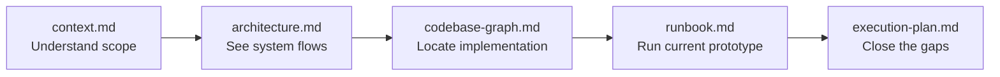

# LOOMCARE Context Pack

## Current V1 entry points

The current application is `app.py` → `care.create_app()`, with SQLite defined in `schema.sql` and browser interfaces under `static/`. It does not import the historical ML/ThingSpeak pipeline.

Start with the updated [runbook](runbook.md). In the running app, `/family` is the customer interface, `/gateway` is the foreground parent bridge/simulator, `/team` is the internal dashboard, `/hardware` includes the India BOM and circuit, and `/plan` contains the staged consumer-app and operations delivery plan.

The older graphs and plans below are retained as an explicitly labelled pre-V1 baseline, not current completion evidence. The V1 is a supervised prototype; native background mobile operation and hardware/clinical validation are not complete.

This directory is the map for the repository. Start with `context.md`, use the
graphs to understand the system, and use the runbook and execution plan to move
from the current prototype to a reliable end-to-end product.

## Documents

| Document | Purpose |
| --- | --- |
| [`context.md`](context.md) | What the repository is, what is implemented, and what is only described |
| [`architecture.md`](architecture.md) | Current runtime, intended product, request sequence, ML lifecycle, and deployment graphs |
| [`codebase-graph.md`](codebase-graph.md) | Folder tree, source dependencies, entry points, and data contracts |
| [`runbook.md`](runbook.md) | Commands for setup, validation, local execution, training, hardware, and deployment |
| [`execution-plan.md`](execution-plan.md) | Prioritized delivery plan with dependencies, outputs, and completion checks |

## Recommended reading order

## Documentation rule

The graphs distinguish between:

- **Observed**: present in this repository and traceable to code or configuration.
- **Intended**: described by the root README or required for the complete product,
  but not implemented in this repository snapshot.

Update this context pack in the same change whenever a component, route, external
service, data contract, or deployment step changes.
