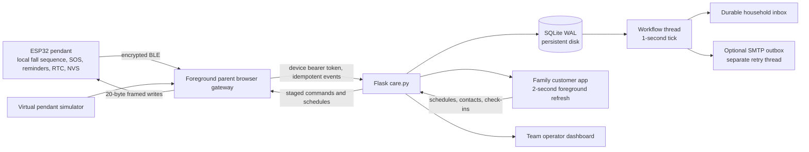
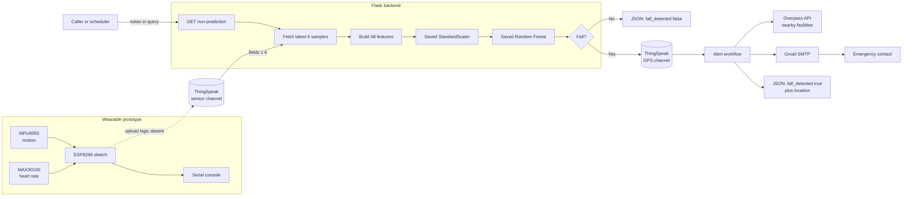
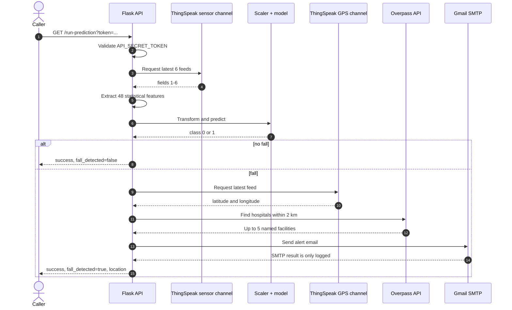
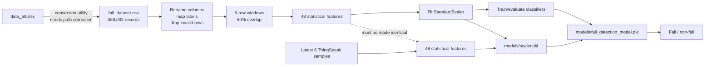
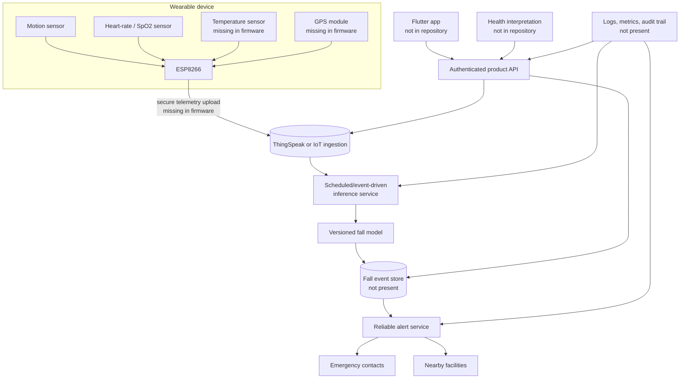
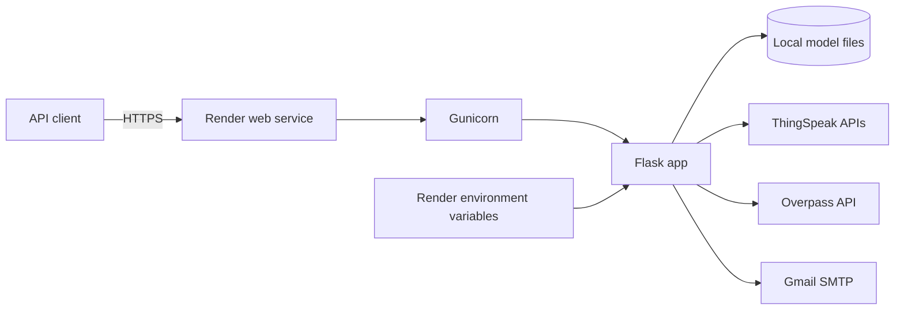

# Architecture Graphs

## Current V1

The gateway caches events in IndexedDB; the pendant retains its oldest event until cloud acceptance is acknowledged. Caregiver incident acknowledgement stops future escalation. A command receipt is not a wearer response. `GET /healthz` checks database access and the worker heartbeat. The old model is not on the V1 path.

Product hardware direction and the connectivity/fallback design are drawn in `static/architecture.svg` and `static/connectivity.svg` and explained on `/hardware`. They are targets, not implemented firmware.

This is a single-host, one-process prototype, not a high-availability architecture. Browser suspension can interrupt the gateway. See `/plan` for the native/background gateway, notification, validation and operations gates.

## Archived pre-V1 graphs

The remaining diagrams describe the old ThingSpeak/Random Forest demo, not current runtime wiring.

## 1. Current implemented runtime

Solid nodes are present in code. The dashed publishing connection is the missing
link between the checked-in firmware and ThingSpeak.

## 2. Prediction and alert sequence

## 3. Model lifecycle

The dotted edge is an important constraint, not a current guarantee. Feature
creation is duplicated between training and inference and already differs in
standard-deviation behavior.

## 4. Intended complete product

This is the target architecture implied by the product README, with missing or
partial repository components explicitly labeled.

## 5. Deployment topology

The deployment graph reflects `render.yaml`; whether the service is currently
deployed and healthy cannot be established from this folder alone.
