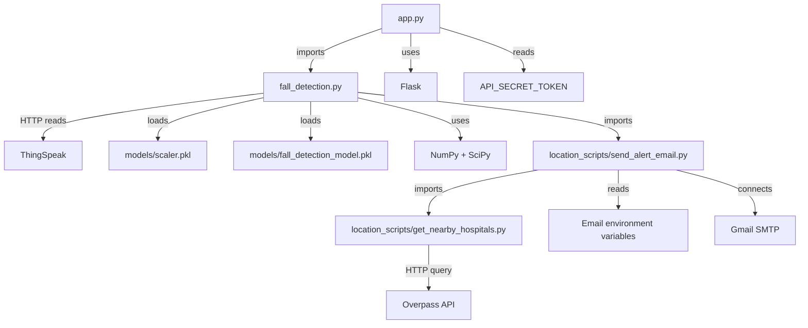
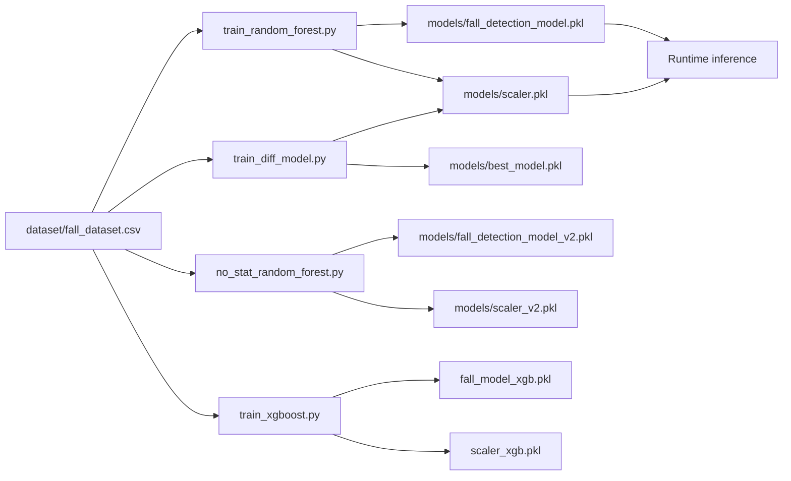
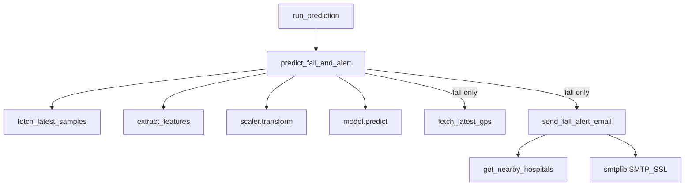

# Codebase Graph

## Current V1 source map

| Path | Responsibility |
| --- | --- |
| `app.py` | Environment loading and application entry point |
| `care.py` | Auth, household/device APIs, event processing, scheduler, SMTP retries and metrics |
| `schema.sql` | SQLite tables, constraints and query indexes |
| `static/app.js`, `style.css`, `index.html` | Family app and internal team dashboard |
| `static/gateway.js` | Virtual pendant, Web Bluetooth bridge, IndexedDB replay |
| `static/hardware.js`, `architecture.svg`, `connectivity.svg` | Product pendant architecture, EVT parts, power budget, connectivity strategy |
| `static/resources.js`, `circuit.svg` | ESP32 software-rig guide/circuit (embedded by `hardware.js`) and rollout plan |
| `hardware_code/pendant/src/main.cpp` | Physical ESP32 controls, sensors, BLE, clock and NVS |
| `hardware_code/pendant/include/fall_detector.h` | Small constant-memory motion-sequence detector |
| `hardware_code/pendant/platformio.ini` | Pinned USB bench and battery firmware builds |
| `tests/test_v1.py` | Offline Python contract, security and workflow tests |
| `tests/browser/journeys.spec.js` | Isolated real-browser customer/gateway/team journeys |
| `tests/detector_test.cpp` | Native synthetic detector checks |
| `tests/benchmark.py` | Clearly scoped local API microbenchmark |
| `Dockerfile`, `render.yaml`, `.env.example` | Single-host deployment and safe configuration defaults |

`data/` contains private local runtime state and is ignored. Model files, datasets, the original sketch, and old Python scripts are retained but excluded from the new deployment image.

## Archived pre-V1 source map

The remainder is historical and does not describe the active `app.py` entry point.

## Folder map

```text
LOOMCARE/
├── app.py                         Flask entry point and HTTP routes
├── fall_detection.py              ThingSpeak fetch, features, inference, orchestration
├── requirements.txt               Runtime Python dependencies
├── render.yaml                    Render/Gunicorn deployment definition
├── hardware_code/
│   └── data_Node_code.ino         ESP8266 sensor-reading firmware; serial output only
├── location_scripts/
│   ├── get_nearby_hospitals.py    Overpass facility lookup
│   ├── send_alert_email.py        Gmail SMTP alert composition and delivery
│   └── test_alert.py              Manual alert example; imports need correction
├── training_scripts/
│   ├── train_random_forest.py     Produces the model used at runtime
│   ├── train_diff_model.py        Compares three classifiers; saves best_model.pkl
│   ├── no_stat_random_forest.py   Raw-feature experiment; saves v2 artifacts
│   └── train_xgboost.py           XGBoost experiment; saves artifacts at repo root
├── models/
│   ├── fall_detection_model.pkl   Runtime classifier
│   └── scaler.pkl                 Runtime scaler
├── dataset/
│   ├── fall_dataset.csv           368,032 sensor records plus header
│   ├── data_all.xlsx              Source spreadsheet
│   └── convertdata.py             Spreadsheet-to-CSV utility; filenames are stale
├── context/                       This repository context pack
├── README.md                      Product-level description
├── Final Report __ Docs.pdf       Project report
├── BAN PPT.pptx                   Presentation
└── *.mp4                          Demonstration videos
```

Generated Python bytecode under `location_scripts/__pycache__/` is not source and
should be ignored/removed from future version-control snapshots.

## Runtime dependency graph



## Training dependency graph



Only `models/fall_detection_model.pkl` and `models/scaler.pkl` are loaded by the
current service. The alternative training outputs are not wired into runtime.

## Call graph



## Entry points and side effects

| Entry point | Invocation | External effects |
| --- | --- | --- |
| Flask development server | `python app.py` | Opens local HTTP server; route calls external APIs and may email |
| Production-style server | `gunicorn app:app` | Same runtime effects |
| Active model training | `python training_scripts/train_random_forest.py` | Reads large CSV and overwrites active model/scaler |
| Model comparison | `python training_scripts/train_diff_model.py` | Reads CSV and overwrites scaler; writes `best_model.pkl` |
| Raw-feature experiment | `python training_scripts/no_stat_random_forest.py` | Writes v2 model/scaler |
| XGBoost experiment | `python training_scripts/train_xgboost.py` | Writes artifacts in repository root |
| Alert example | `python location_scripts/test_alert.py` | Intended to send a real email; import layout currently needs repair |
| Firmware | Upload `hardware_code/data_Node_code.ino` | Connects to configured Wi-Fi and reads physical sensors |

## Change-impact guide

| If you change… | Also verify… |
| --- | --- |
| ThingSpeak field order | Firmware publisher, `fetch_latest_samples`, feature tests, trained model |
| Window size | Training windowing, runtime fetch count, model/scaler, latency |
| Feature formulas/order | Shared feature schema, retrained scaler/model, inference tests |
| Model filename | Training output, runtime loader, deployment bundle |
| Alert payload | Email templates, delivery status, tests, API response contract |
| API route or auth | Clients/scheduler, Render settings, README, security tests |
| Environment variables | Local `.env` guidance and Render secret configuration |
