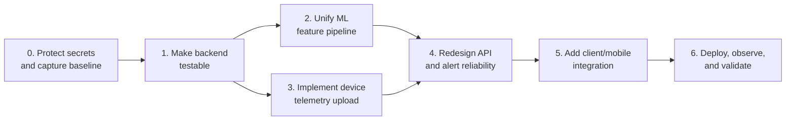
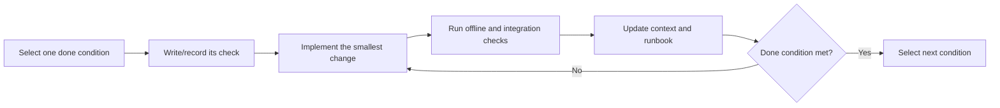

# Execution Plan

## V1 prototype delivery and next gates

The implementation now supplies family, parent gateway/simulator and team web interfaces; an Expo phone app with family and invisible parent-gateway modes; a persistent authenticated backend with multi-gateway relaying, Care Circle roles, push and webhook escalation, inventory and support notes; Zephyr firmware for the finalized XIAO nRF54L15 + BMI270 prototype; the ESP32 software rig; BOMs, cost targets, diagrams, and deployment/test tooling. The interactive `/plan` page is the detailed current roadmap.

1. Verify the complete virtual customer journey using the runbook and isolated browser suite.
2. Build 5–10 XIAO nRF54L15 + BMI270 units (≤ ₹3,000 each), flash `hardware_code/pendant_nrf54`, and measure pairing, range, detection behaviour and current. Then add the BMI270 any-motion wake and a compact binary protocol, and design the bare-chip production board and sealed cradle-charged housing (≤ ₹2,000 at volume; see `/hardware`).
2a. Finish connectivity redundancy: build the Home Hub, connect the webhook to an SMS/voice provider, and walk-test homes measuring time without any working path.
3. Measure detector performance using pendant-position data and controlled fixtures; establish and agree false-alarm, missed-fall and latency targets before wearer trials.
4. Run the phone app as development builds on the Android models you support; validate background relaying, reconnection, reboot behaviour and push delivery. Add recovery, consent, accessibility, multilingual UX and deletion workflows.
5. Harden team operations: MFA, audited access reviews, device replacement flows, secure firmware releases, provider monitoring and incident ownership.
6. Before broad deployment, add managed database migrations, independent durable workers, restore-tested backups, retention, security review, relevant compliance review and hardware/human-factors sign-off.

Do not reintroduce the cloud Random Forest or complete the old ThingSpeak uploader as prerequisites for V1. V1 uses local detection and BLE. Voice, cellular, GNSS, health AI and ambient sensors remain later-version work.

## Archived pre-V1 improvement plan

The remaining phases are retained as analysis of the original demo. They are superseded by the V1 architecture and are not a list of currently missing web-app features.

## Goal

Turn the current demonstration into a secure, reproducible end-to-end system in
which the wearable publishes a documented telemetry schema, the backend produces
testable predictions, and every alert has an observable delivery outcome.

## Dependency graph

## Phase 0 — Protect secrets and preserve a baseline

Tasks:

- Rotate the Wi-Fi password and ThingSpeak keys currently present in source.
- Remove secret-value logging from the email module.
- Remove the default API token and fail startup when required configuration is
  absent.
- Move channel IDs, API keys, coordinates, username, SMTP host/port, and alert
  recipients into validated configuration.
- Create `.env.example` with names and safe placeholders only.
- Put the project under version control if this folder is the working copy; no
  `.git` metadata is present in the current snapshot.
- Record a known six-row sensor window, expected 48-feature vector, model version,
  and expected prediction as a baseline fixture.

Done when:

- Secret scanning finds no live credential values in tracked source.
- Startup fails clearly when mandatory configuration is missing.
- A baseline fixture can be evaluated without internet or email access.

## Phase 1 — Make the backend testable

Tasks:

- Split configuration, ThingSpeak access, feature extraction, model inference,
  location lookup, and email delivery behind explicit functions/interfaces.
- Add timeouts and status checks to every HTTP request.
- Replace broad `except:` blocks with specific exceptions and structured errors.
- Resolve model paths from the module/project path rather than the current
  working directory.
- Add unit tests with mocked ThingSpeak, Overpass, model, and SMTP boundaries.
- Add API tests for health, unauthorized, insufficient-data, no-fall, fall, GPS
  fallback, and alert-delivery failure paths.
- Add CI to run formatting/linting, compilation, and tests.

Done when:

- Tests run offline and cannot send email.
- Every external call has a timeout and a tested failure path.
- Starting the app from another working directory still loads the model.

## Phase 2 — Eliminate training/serving skew

Tasks:

- Create one shared feature module used by training and inference.
- Define a versioned schema: exact signal names, units, order, window size,
  sampling rate, missing-data policy, and 48 feature names.
- Decide whether runtime gyro values represent `gx/gy/gz` or
  `droll/dpitch/dyaw`; retrain if the deployed sensor semantics differ.
- Use the same standard-deviation convention and NaN policy in both paths.
- Package preprocessing and classifier as one scikit-learn pipeline where
  practical.
- Pin training/runtime dependencies and save metadata with the artifact:
  training code version, schema version, metrics, data split, and timestamp.
- Evaluate on subject/session-separated data to reduce leakage from overlapping
  windows.

Done when:

- One raw fixture produces numerically equivalent features in training and
  service tests.
- An artifact is rejected when its schema version does not match the service.
- Evaluation is reproducible from documented commands.

## Phase 3 — Complete wearable-to-cloud telemetry

Tasks:

- Define the ThingSpeak field mapping and units in code and documentation.
- Add bounded, non-blocking Wi-Fi reconnect behavior to the ESP8266 firmware.
- Publish motion fields at an intentional rate that respects ThingSpeak limits.
- Add GPS and temperature only if they are still product requirements.
- Do not log or embed credentials in the committed sketch; provision them
  locally or through a secrets header excluded from version control.
- Add timestamps, device ID, and basic data-quality indicators.
- Capture an end-to-end sample from physical sensor to backend fixture.

Done when:

- Six consecutive valid records reach the configured channel with the documented
  order and units.
- Backend inference succeeds against a controlled device test without manually
  inserting data.
- Disconnect/reconnect and missing-sensor behavior are documented and tested.

## Phase 4 — Make prediction and alerts reliable

Tasks:

- Keep `GET /health` side-effect free.
- Replace side-effecting GET prediction with an authenticated POST endpoint or a
  scheduled/event-driven worker.
- Validate request/source data and return stable response schemas.
- Add event IDs, timestamps, model version, location source, and alert status.
- Separate fall detection from notification delivery so retries do not repeat
  inference or create duplicate incidents.
- Add idempotency/deduplication and configurable cooldown rules.
- Propagate alert delivery success/failure and log it without exposing secrets or
  personal data.
- Use HTTPS for external HTTP services and define GPS fallback policy explicitly.

Done when:

- Replaying one event cannot send duplicate alerts.
- Callers can distinguish prediction, event creation, and delivery outcomes.
- Failure/retry behavior is covered by automated tests.

## Phase 5 — Add the product client

Tasks:

- Decide whether the missing Flutter application is recovered from another
  repository or rebuilt here.
- Publish an OpenAPI contract before client implementation.
- Implement authentication, current sensor status, recent fall events, emergency
  contacts, and alert acknowledgement.
- Treat generative health interpretation as a separate, optional service with
  medical-safety boundaries; do not couple it to emergency fall detection.
- Add accessibility, empty/offline/error states, and consent/privacy flows.

Done when:

- The client uses only documented APIs and contains no backend secrets.
- A test user can receive, view, and acknowledge a simulated event end to end.

## Phase 6 — Deploy and validate

Tasks:

- Create separate development/staging/production configuration and channels.
- Add structured logs, latency/error metrics, alert-delivery metrics, and health
  checks.
- Add model and API version reporting.
- Run staged sensor, outage, false-positive, false-negative, and notification
  drills.
- Document ownership, escalation, data retention, privacy, and incident response.
- Update the root README to report observed status instead of a blanket 100%.

Done when:

- A staging drill is traceable from telemetry through prediction to alert receipt.
- Operators can detect stale telemetry and failed delivery without waiting for a
  user report.
- Production launch has explicit technical and safety sign-off.

## How to execute the plan

Use one small vertical milestone at a time:

For each milestone:

1. Create a short issue containing scope, risk, and one observable done condition.
2. Add or capture the verification before changing behavior.
3. Keep secrets and live alert recipients out of development tests.
4. Implement one layer at a time; mock external systems in unit tests.
5. Run syntax/tests, then a staging integration check.
6. Update this context pack when the system boundary or contract changes.
7. Promote only after the done condition is demonstrated and recorded.

## Suggested first five work items

1. Rotate/remove exposed secrets and stop credential logging.
2. Add configuration validation plus `.env.example`.
3. Add offline tests around the current 48-feature extraction and API paths.
4. Move feature extraction into one shared module and retrain/version the model.
5. Implement and verify the ESP8266-to-ThingSpeak field contract.
